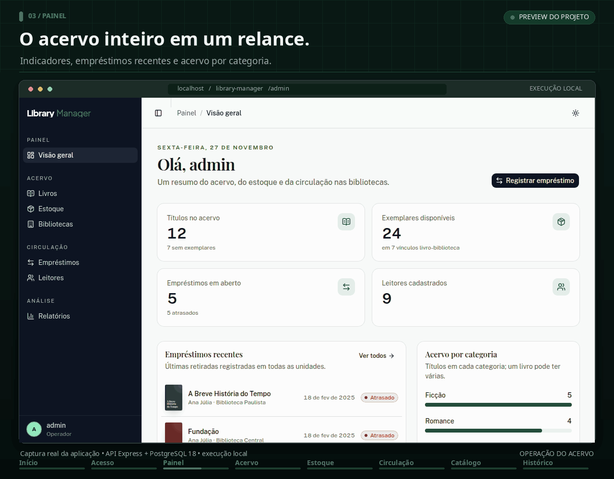

# Library Manager App

### Demonstração visual

Conheça a interface sem instalar nada: **um tour de 34 segundos** com capturas reais da aplicação executada localmente, legendas em português e destaque das interações. Todas as operações mostradas são gravadas no PostgreSQL pela API.

<p align="center">
  
  <br>
  <sub>Visão geral · 34 segundos · Reprodução em loop</sub>
</p>

**Gestão de bibliotecas · React + shadcn/ui + Express + PostgreSQL**

[Português (Brasil)](#pt-br) · [English](#english)

---

<a id="pt-br"></a>

## Português (Brasil)

### Sobre o projeto

O Library Manager App é um sistema acadêmico full-stack de gestão de bibliotecas, desenvolvido originalmente para a disciplina de Banco de Dados I do CEFET-MG. Este repositório reúne o frontend React e a API REST Node.js do projeto original, mantendo as aplicações independentes para desenvolvimento e build.

O domínio da aplicação abrange leitores, operadores, livros, bibliotecas, estoque, empréstimos, autenticação e relatórios administrativos. O PostgreSQL armazena os dados e implementa parte das regras de negócio por meio de relacionamentos, funções e gatilhos presentes no SQL original.

### Funcionalidades

**Leitores**

- Catálogo de todas as bibliotecas com busca por título ou autor, filtro por categoria, ordenação e opção de mostrar apenas títulos disponíveis.
- Ficha do livro com a disponibilidade em cada biblioteca e pedido de empréstimo com um clique.
- Histórico de empréstimos com prazos, situação (em andamento, atrasado, devolvido) e limite de uso.
- Cadastro com validação de CPF, telefone, CEP e endereço.

**Operadores**

- Painel com indicadores, empréstimos recentes, acervo por categoria e bibliotecas com mais exemplares.
- Cadastro, edição e exclusão de livros.
- Estoque por biblioteca com ajuste de quantidade direto na tabela.
- Registro de empréstimos e devoluções, com filtros por situação.
- Cadastro e edição de bibliotecas, lista de leitores e relatórios exportáveis em CSV.

**Interface**

- Construída com shadcn/ui sobre Radix UI, com temas claro e escuro e layout responsivo.
- Estados de carregamento, vazio e erro em todas as telas, além de notificações e mensagens de validação em português.
- Regras do banco, como limite de 5 empréstimos, prazo de 30 dias e reajuste máximo de preço, aparecem como mensagens claras.
- Auditoria de acessibilidade com axe-core (WCAG 2.1 AA) sem violações nos temas claro e escuro.

#### Operação do acervo

Painel, edição de livro, ajuste de estoque e devolução de um empréstimo atrasado, todos gravados no banco.

<p align="center">
  
  <br>
  <sub>Operadores · Painel, livros, estoque e circulação</sub>
</p>

#### Área do leitor

Busca no catálogo, disponibilidade por biblioteca, pedido de empréstimo e histórico atualizado.

<p align="center">
  
  <br>
  <sub>Leitores · Catálogo, empréstimo e histórico</sub>
</p>

O processo de gravação e as instruções para recriar os GIFs estão em [`preview/README.md`](./preview/README.md). A [ilustração original](./preview/domestic-life-illustrated.jpg) foi preservada.

### Tecnologias

| Camada | Tecnologias |
| --- | --- |
| Frontend | React 19, TypeScript 6, Vite 8, React Router 8, Tailwind CSS 4, shadcn/ui (Radix UI), TanStack Query 5, React Hook Form + Zod, Sonner, Lucide |
| Backend | Node.js 24, Express 5, JWT, cliente `pg` |
| Banco de dados | PostgreSQL 18 |
| Infraestrutura local | Docker, Docker Compose e Nginx 1.30 |
| Qualidade | Jest 30 (unitários e integração), ESLint 10, Prettier, verificação de tipos e GitHub Actions |

### Estrutura do projeto

```text
library-manager-app/
├── .github/workflows/ci.yml       # Pipeline de integração contínua
├── backend/
│   ├── database/init.sql          # Estrutura do banco e dados de exemplo
│   ├── src/                       # Rotas, controladores, serviços, repositórios e modelos
│   ├── test/unit/                 # Testes de middlewares e utilitários
│   ├── test/integration/          # Testes HTTP com PostgreSQL
│   └── Dockerfile
├── frontend/
│   ├── src/app/                   # Provedores e rotas
│   ├── src/components/ui/         # Componentes gerados pelo shadcn/ui
│   ├── src/components/            # Componentes da aplicação
│   ├── src/layouts/               # Site, autenticação, leitor e operador
│   ├── src/lib/                   # Cliente da API, sessão, consultas e formatação
│   ├── src/pages/                 # Páginas públicas, do leitor (reader/) e do operador (admin/)
│   ├── nginx.conf                 # Hospedagem SPA e proxy reverso de /api
│   └── Dockerfile
├── preview/                       # GIFs, documentação e ferramentas de captura
├── docker-compose.yml
└── README.md
```

O backend mantém a organização em camadas do projeto original: rotas recebem as requisições HTTP, controladores coordenam os casos de uso, serviços implementam o comportamento da aplicação, repositórios isolam a persistência e modelos executam consultas PostgreSQL.

### Executar com Docker Compose

**Requisitos:** Docker Engine ou Docker Desktop e Docker Compose v2 ou superior.

Na raiz do repositório, inicie os três serviços:

```bash
docker compose up --build
```

Quando as verificações de saúde passarem, acesse:

- **Aplicação web:** [http://localhost:8080](http://localhost:8080)
- **Verificação da API:** [http://localhost:3000/health](http://localhost:3000/health)

| Serviço | Responsabilidade |
| --- | --- |
| `frontend` | Gera o build React e o disponibiliza pelo Nginx |
| `backend` | Executa a API REST Express |
| `database` | Inicializa o PostgreSQL 18 com `backend/database/init.sql` na primeira criação do volume |

Para encerrar, use `docker compose down`.

> **Atenção:** executar `docker compose down --volumes` remove o volume do banco e apaga as alterações locais. Use esse comando apenas se quiser recriar o banco a partir do SQL inicial na próxima execução.

> **Atualizando de uma versão anterior:** o banco passou do PostgreSQL 16 para o 18 e agora usa o volume `postgres18_data`. O volume antigo não é aberto pelo novo servidor; se não precisar mais dele, remova-o com `docker volume rm library-manager-app_postgres_data`.

#### Configuração

Os valores padrão são adequados **somente para desenvolvimento local**. Copie o arquivo de exemplo antes de alterar portas, credenciais ou segredos:

```bash
cp .env.example .env
```

| Variável | Padrão | Finalidade |
| --- | --- | --- |
| `FRONTEND_PORT` | `8080` | Porta local da aplicação web |
| `BACKEND_PORT` | `3000` | Porta local para acesso direto à API |
| `DATABASE_PORT` | `5432` | Porta PostgreSQL restrita ao loopback para testes de integração |
| `POSTGRES_DB` | `gomes_library_system` | Nome do banco |
| `POSTGRES_USER` | `gomes_library_system_user` | Usuário PostgreSQL |
| `POSTGRES_PASSWORD` | `library_manager_password` | Senha local do PostgreSQL |
| `SECRET_KEY` | `local-development-secret` | Segredo de assinatura dos tokens JWT |
| `OPERATOR_REGISTRATION_KEY` | `Admin` | Chave exigida pela API para cadastrar operadores; sem ela, o cadastro fica desativado |
| `CORS_ORIGIN` | `http://localhost:8080` | Origem permitida para o navegador |

O banco inicial contém registros de demonstração. **Não reutilize estas credenciais fora de uma demonstração local:**

| Perfil | Acesso | Senha |
| --- | --- | --- |
| Operador | usuário `admin` | `admin` |
| Leitor | CPF `321.687.810-44` (João Pedro) | `1234` |

### Desenvolvimento local

Requisitos: Node.js 22.22 ou superior (Node.js 24 recomendado) e um PostgreSQL com o `init.sql` carregado. O jeito mais simples é usar o serviço do Compose:

```bash
docker compose up -d database
```

**Backend** (configure `backend/.env` a partir de `backend/.env.example`):

```bash
cd backend
npm ci
npm run dev
```

**Frontend, em outro terminal:**

```bash
cd frontend
npm ci
npm run dev
```

Ao executar o Vite diretamente, defina `VITE_API_URL=http://localhost:3000` em `frontend/.env`. No Docker, o frontend usa `/api`, encaminhado pelo Nginx ao backend.

Novos componentes do shadcn/ui são adicionados com `npx shadcn add <componente>` dentro de `frontend/`.

### Testes e verificações

**Backend:**

```bash
cd backend
npm run test:unit          # sem banco de dados
npm run test:integration   # requer o PostgreSQL com init.sql e as variáveis de backend/.env.example
```

**Frontend:**

```bash
cd frontend
npm run format:check
npm run lint
npm run typecheck
npm run build
```

O pipeline do GitHub Actions executa formatação, lint e build do frontend, testes unitários e de integração do backend com PostgreSQL 18 e validação da configuração do Docker Compose em pull requests e pushes para `main` ou `master`.

### Principais recursos da API

Os endpoints públicos incluem `/health`, cadastro e login em `/auth` e cadastro de leitores em `POST /user`. Os demais exigem JWT no cabeçalho `Authorization: Bearer <token>`.

| Recurso | Finalidade |
| --- | --- |
| `/book` | Administração do catálogo de livros |
| `/library` | Administração de bibliotecas |
| `/bookLibrary` | Estoque de livros por biblioteca |
| `/loan` | Empréstimos e devoluções |
| `/user` | Registros de leitores |
| `/report/*` | Relatórios de catálogo, disponibilidade, empréstimos e bibliotecas |

**Perfis:** tokens de operador acessam todos os recursos. Tokens de leitor podem consultar o catálogo, os livros, as bibliotecas e o estoque, ler o próprio cadastro e histórico e criar empréstimos apenas no próprio CPF; o restante responde `403`.

**Respostas de erro:** credenciais inválidas respondem `401`; conflitos de chave única ou estrangeira, `409`; violações de regras do banco (gatilhos e restrições), `422` com a mensagem da regra; dados ausentes ou inválidos, `400`; registros inexistentes, `404`.

### Apresentação original

O vídeo de apresentação do projeto está disponível no [YouTube](https://www.youtube.com/watch?v=_SDEl3swxnw).

### Créditos

- **Autor:** Lucas Henrique
- **Colaboradora:** Maria Vitória Peixoto
- **Ilustração original:** [Freepik AI Illustration](https://www.freepik.com/free-ai-image/domestic-life-illustrated_381099438.htm)

### Licença

Este projeto acadêmico mantém a licença ISC declarada no pacote do backend.

[Voltar ao início](#library-manager-app) · [Read in English ↓](#english)

---

<a id="english"></a>

## English

**Library management · React + shadcn/ui + Express + PostgreSQL**

[Ler em português ↑](#pt-br)

### About the project

Library Manager App is a full-stack academic library management system originally developed for the Database I course at CEFET-MG. This repository brings the React frontend and the Node.js REST API together in one project while keeping each application isolated and independently buildable.

The application manages readers, operators, books, libraries, inventory, loans, authentication, and administrative reports. PostgreSQL stores the domain data and enforces part of the business logic through relationships, functions, and triggers included in the original database dump.

### Features

**Readers**

- A catalog across all libraries with title or author search, category filter, sorting, and an available-only toggle.
- A book sheet showing availability in each library and one-click loan requests.
- Loan history with due dates, status (active, overdue, returned), and the open-loan limit.
- Sign-up with CPF, phone, postal code, and address validation.

**Operators**

- A dashboard with key figures, recent loans, titles per category, and the libraries with the most copies.
- Book creation, editing, and deletion.
- Per-library stock with quantity adjustments directly in the table.
- Loan and return registration with status filters.
- Library creation and editing, a reader directory, and reports exportable as CSV.

**Interface**

- Built with shadcn/ui on Radix UI, with light and dark themes and a responsive layout.
- Loading, empty, and error states on every screen, plus toasts and validation messages in Portuguese.
- Database rules, such as the 5-loan limit, the 30-day period, and the maximum price change, surface as clear messages.
- Accessibility audited with axe-core (WCAG 2.1 AA) with no violations in either theme.

### Visual demonstration

The following preview is a **34-second tour of the actual application running locally**, with Portuguese captions, highlighted interactions, and a continuous loop. Every operation shown is persisted to PostgreSQL through the API.

<p align="center">
  
  <br>
  <sub>Overview · 34 seconds · Continuous loop</sub>
</p>

#### Operating the collection

Dashboard, book editing, stock adjustment, and returning an overdue loan, all saved to the database.

<p align="center">
  
  <br>
  <sub>Operators · Dashboard, books, stock, and circulation</sub>
</p>

#### Reader area

Catalog search, availability per library, a loan request, and the updated history.

<p align="center">
  
  <br>
  <sub>Readers · Catalog, borrowing, and history</sub>
</p>

See [`preview/README.md`](./preview/README.md) for the recording process and instructions to regenerate the previews. The [original illustration](./preview/domestic-life-illustrated.jpg) is preserved.

### Technology stack

| Layer | Technologies |
| --- | --- |
| Frontend | React 19, TypeScript 6, Vite 8, React Router 8, Tailwind CSS 4, shadcn/ui (Radix UI), TanStack Query 5, React Hook Form + Zod, Sonner, Lucide |
| Backend | Node.js 24, Express 5, JWT, and the `pg` client |
| Database | PostgreSQL 18 |
| Local infrastructure | Docker, Docker Compose, and Nginx 1.30 |
| Quality | Jest 30 (unit and integration), ESLint 10, Prettier, type checking, and GitHub Actions |

### Project structure

```text
library-manager-app/
├── .github/workflows/ci.yml       # Continuous integration pipeline
├── backend/
│   ├── database/init.sql          # Schema and sample data
│   ├── src/                       # Routers, controllers, services, repositories, and models
│   ├── test/unit/                 # Middleware and utility tests
│   ├── test/integration/          # HTTP and PostgreSQL integration tests
│   └── Dockerfile
├── frontend/
│   ├── src/app/                   # Providers and routes
│   ├── src/components/ui/         # Components generated by shadcn/ui
│   ├── src/components/            # Application components
│   ├── src/layouts/               # Site, auth, reader, and operator layouts
│   ├── src/lib/                   # API client, session, queries, and formatting
│   ├── src/pages/                 # Public, reader (reader/), and operator (admin/) pages
│   ├── nginx.conf                 # SPA hosting and /api reverse proxy
│   └── Dockerfile
├── preview/                       # GIFs, documentation, and capture tools
├── docker-compose.yml
└── README.md
```

The backend keeps the original layered design: routers receive HTTP requests, controllers coordinate use cases, services hold application behavior, repositories isolate persistence operations, and models execute PostgreSQL queries.

### Run with Docker Compose

Requirements:

- Docker Engine or Docker Desktop
- Docker Compose v2 or later

Start the complete stack:

```bash
docker compose up --build
```

Once all health checks pass, open:

- Web application: [http://localhost:8080](http://localhost:8080)
- API health endpoint: [http://localhost:3000/health](http://localhost:3000/health)

The stack contains three services:

- `frontend` builds the React application and serves it through Nginx.
- `backend` runs the Express REST API.
- `database` initializes PostgreSQL 18 with `backend/database/init.sql` the first time its volume is created.

Stop the stack with `docker compose down`. To deliberately recreate the database from the seed dump, remove its volume with `docker compose down --volumes` and start the stack again. This deletes local database changes.

> **Upgrading from an earlier version:** the database moved from PostgreSQL 16 to 18 and now uses the `postgres18_data` volume. The new server never opens the old volume; if you no longer need it, remove it with `docker volume rm library-manager-app_postgres_data`.

#### Configuration

The included defaults are suitable only for local development. Copy `.env.example` to `.env` before changing ports, credentials, or secrets:

```bash
cp .env.example .env
```

| Variable | Default | Purpose |
| --- | --- | --- |
| `FRONTEND_PORT` | `8080` | Host port for the web application |
| `BACKEND_PORT` | `3000` | Host port for direct API access |
| `DATABASE_PORT` | `5432` | Loopback-only PostgreSQL port for local integration tests |
| `POSTGRES_DB` | `gomes_library_system` | PostgreSQL database name |
| `POSTGRES_USER` | `gomes_library_system_user` | PostgreSQL user |
| `POSTGRES_PASSWORD` | `library_manager_password` | Local PostgreSQL password |
| `SECRET_KEY` | `local-development-secret` | JWT signing secret |
| `OPERATOR_REGISTRATION_KEY` | `Admin` | Key the API requires to register operators; without it, operator sign-up is disabled |
| `CORS_ORIGIN` | `http://localhost:8080` | Allowed browser origin |

The seeded database includes demonstration records. Never reuse these credentials outside a local demonstration:

| Profile | Login | Password |
| --- | --- | --- |
| Operator | user `admin` | `admin` |
| Reader | CPF `321.687.810-44` (João Pedro) | `1234` |

### Local development

Requirements: Node.js 22.22 or later (Node.js 24 recommended) and a PostgreSQL database loaded with `init.sql`. The simplest option is the Compose service:

```bash
docker compose up -d database
```

Backend (configure `backend/.env` from `backend/.env.example`):

```bash
cd backend
npm ci
npm run dev
```

Frontend:

```bash
cd frontend
npm ci
npm run dev
```

Set `VITE_API_URL=http://localhost:3000` in `frontend/.env` when running Vite directly. The Docker setup uses `/api`, which Nginx proxies to the backend service.

Add new shadcn/ui components with `npx shadcn add <component>` inside `frontend/`.

### Tests

Backend:

```bash
cd backend
npm run test:unit          # no database required
npm run test:integration   # requires PostgreSQL with init.sql and the variables in backend/.env.example
```

Frontend:

```bash
cd frontend
npm run format:check
npm run lint
npm run typecheck
npm run build
```

The GitHub Actions pipeline runs frontend formatting, lint, and build checks, backend unit tests, PostgreSQL 18 integration tests, and Docker Compose configuration validation on pull requests and pushes to `main` or `master`.

### Main API resources

Public endpoints include `/health`, sign-up and login under `/auth`, and reader registration at `POST /user`. All remaining resources require a JWT in the `Authorization: Bearer <token>` header.

- `/book` — book catalog administration
- `/library` — library administration
- `/bookLibrary` — library inventory
- `/loan` — loans and returns
- `/user` — reader records
- `/report/*` — catalog, availability, loan, and library reports

**Roles:** operator tokens can reach every resource. Reader tokens can browse the catalog, books, libraries, and stock, read their own profile and loan history, and create loans only for their own CPF; everything else answers `403`.

**Error responses:** invalid credentials answer `401`; unique or foreign-key conflicts, `409`; database rule violations (triggers and constraints), `422` with the rule's message; missing or invalid input, `400`; missing records, `404`.

### Project presentation

The original presentation video is available on [YouTube](https://www.youtube.com/watch?v=_SDEl3swxnw).

### Credits

- Author: Lucas Henrique
- Contributor: Maria Vitória Peixoto

Original illustration: [Freepik AI Illustration](https://www.freepik.com/free-ai-image/domestic-life-illustrated_381099438.htm)

### License

This academic project retains the ISC license declared by the backend package.

[Back to top](#library-manager-app) · [Ler em português](#pt-br)
