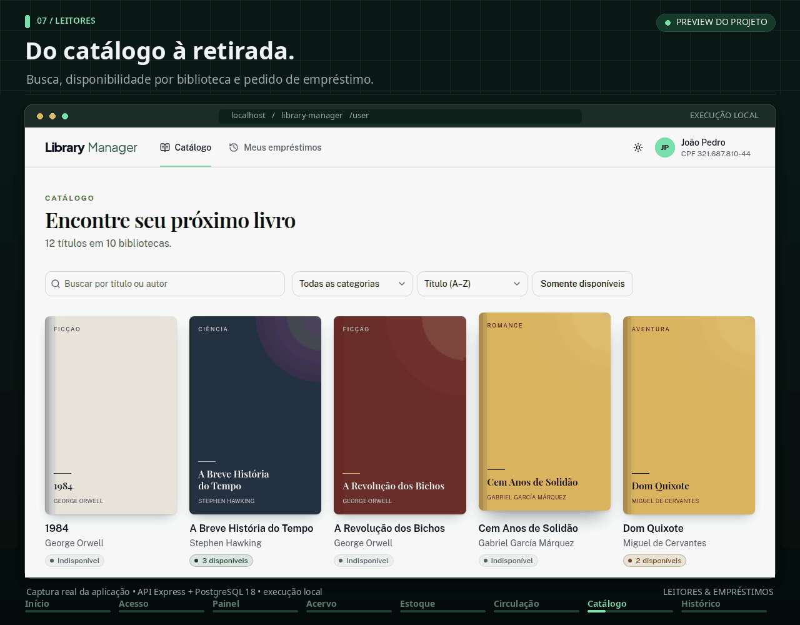

# Library Manager App

**Gestão de bibliotecas · React + Express + PostgreSQL**

[Português (Brasil)](#pt-br) · [English](#english)

---

<a id="pt-br"></a>

## Português (Brasil)

### Sobre o projeto

O Library Manager App é um sistema acadêmico full-stack de gestão de bibliotecas, desenvolvido originalmente para a disciplina de Banco de Dados I do CEFET-MG. Este repositório reúne o frontend React e a API REST Node.js do projeto original, mantendo as aplicações independentes para desenvolvimento e build.

O domínio da aplicação abrange leitores, operadores, livros, bibliotecas, estoque, empréstimos, autenticação e relatórios administrativos. O PostgreSQL armazena os dados e implementa parte das regras de negócio por meio de relacionamentos, funções e gatilhos presentes no SQL original.

### Demonstração visual

Conheça a interface sem instalar nada: **um tour de 26 segundos**, com capturas reais da aplicação executada localmente, legendas em português e destaque das interações.

<p align="center">
  
  <br>
  <sub>Visão geral · 26 segundos · Reprodução em loop</sub>
</p>

#### Gestão do acervo e disponibilidade

Edição dos campos de um livro e ajuste da quantidade de exemplares na interface administrativa.

<p align="center">
  
  <br>
  <sub>Administração · Edição de livros e quantidade de exemplares</sub>
</p>

#### Área do leitor e histórico de empréstimos

Consulta à ficha de exemplo, abertura do pop-up de bibliotecas e visualização do histórico com livros, bibliotecas e datas.

<p align="center">
  
  <br>
  <sub>Leitores · Consulta de bibliotecas e histórico</sub>
</p>

> **Estado atual da implementação:** o login de operador gravado usa a API Express e o PostgreSQL reais. A ficha do leitor, a lista de bibliotecas e o histórico contêm dados de exemplo; as edições de livros e estoque mostradas usam estado local do React, sem persistência no banco. Algumas seções são abertas diretamente porque seus botões de navegação ainda não estão conectados. Os GIFs não demonstram fluxos completos de cadastro de livros, realização de empréstimos ou relatórios.

O processo de gravação, as limitações e as instruções para recriar os GIFs estão em [`preview/README.md`](./preview/README.md). A [ilustração original](./preview/domestic-life-illustrated.jpg) foi preservada.

### Tecnologias

| Camada | Tecnologias |
| --- | --- |
| Frontend | React 18, Vite, React Router e Tailwind CSS |
| Backend | Node.js 20, Express, JWT e cliente PostgreSQL |
| Banco de dados | PostgreSQL 16 |
| Infraestrutura local | Docker, Docker Compose e Nginx |
| Qualidade | Testes unitários e de integração com Jest, ESLint e GitHub Actions |

### Estrutura do projeto

```text
library-manager-app/
├── .github/workflows/ci.yml       # Pipeline de integração contínua
├── backend/
│   ├── database/init.sql          # Estrutura do banco e dados de exemplo
│   ├── src/                       # Camadas da API e configuração da aplicação
│   ├── test/unit/                 # Testes isolados de middleware
│   ├── test/integration/          # Testes HTTP com PostgreSQL
│   └── Dockerfile
├── frontend/
│   ├── src/                       # Aplicação React
│   ├── nginx.conf                 # Hospedagem SPA e proxy reverso de /api
│   └── Dockerfile
├── preview/                       # GIFs, documentação e ferramentas de captura
├── docker-compose.yml
└── README.md
```

O backend mantém a organização em camadas do projeto original: rotas recebem as requisições HTTP, controladores coordenam os casos de uso, serviços implementam o comportamento da aplicação, repositórios isolam a persistência e modelos executam consultas PostgreSQL.

### Executar com Docker Compose

**Requisitos:** Docker Engine ou Docker Desktop e Docker Compose v2 ou superior.

Na raiz do repositório, inicie os três serviços:

```bash
docker compose up --build
```

Quando as verificações de saúde passarem, acesse:

- **Aplicação web:** [http://localhost:8080](http://localhost:8080)
- **Verificação da API:** [http://localhost:3000/health](http://localhost:3000/health)

| Serviço | Responsabilidade |
| --- | --- |
| `frontend` | Gera o build React e o disponibiliza pelo Nginx |
| `backend` | Executa a API REST Express |
| `database` | Inicializa o PostgreSQL com `backend/database/init.sql` na primeira criação do volume |

Para encerrar, use `docker compose down`.

> **Atenção:** executar `docker compose down --volumes` remove o volume do banco e apaga as alterações locais. Use esse comando apenas se quiser recriar o banco a partir do SQL inicial na próxima execução.

#### Configuração

Os valores padrão são adequados **somente para desenvolvimento local**. Copie o arquivo de exemplo antes de alterar portas, credenciais ou o segredo JWT:

```bash
cp .env.example .env
```

| Variável | Padrão | Finalidade |
| --- | --- | --- |
| `FRONTEND_PORT` | `8080` | Porta local da aplicação web |
| `BACKEND_PORT` | `3000` | Porta local para acesso direto à API |
| `DATABASE_PORT` | `5432` | Porta PostgreSQL restrita ao loopback para testes de integração |
| `POSTGRES_DB` | `gomes_library_system` | Nome do banco |
| `POSTGRES_USER` | `gomes_library_system_user` | Usuário PostgreSQL |
| `POSTGRES_PASSWORD` | `library_manager_password` | Senha local do PostgreSQL |
| `SECRET_KEY` | `local-development-secret` | Segredo de assinatura dos tokens JWT |
| `CORS_ORIGIN` | `http://localhost:8080` | Origem permitida para o navegador |

O banco inicial contém registros de demonstração. Por exemplo, o operador `admin` usa a senha `admin`. **Não reutilize essas credenciais fora de uma demonstração local.**

### Desenvolvimento local

Inicie o PostgreSQL e configure o backend com base em `backend/.env.example`.

**Backend:**

```bash
cd backend
npm ci
npm run dev
```

**Frontend, em outro terminal:**

```bash
cd frontend
npm ci
npm run dev
```

Ao executar o Vite diretamente, defina `VITE_API_URL=http://localhost:3000` em `frontend/.env`. No Docker, o frontend usa `/api`, encaminhado pelo Nginx ao backend.

### Testes e verificações

**Testes unitários do backend:**

```bash
cd backend
npm ci
npm run test:unit
```

Os testes de integração exigem o PostgreSQL inicializado com os dados do projeto e as variáveis de ambiente indicadas em `backend/.env.example`:

```bash
cd backend
npm run test:integration
```

**Lint e build do frontend:**

```bash
cd frontend
npm run lint
npm run build
```

O pipeline do GitHub Actions executa lint e build do frontend, testes unitários e de integração do backend com PostgreSQL e validação da configuração do Docker Compose em pull requests e pushes para `main` ou `master`.

### Principais recursos da API

Os endpoints públicos incluem `/health`, cadastro e login de operadores em `/auth` e cadastro de leitores em `/user`. Os demais recursos exigem JWT no cabeçalho `Authorization: Bearer <token>`.

| Recurso | Finalidade |
| --- | --- |
| `/book` | Administração do catálogo de livros |
| `/library` | Administração de bibliotecas |
| `/bookLibrary` | Estoque de livros por biblioteca |
| `/loan` | Empréstimos e devoluções |
| `/user` | Registros de leitores |
| `/report/*` | Relatórios de catálogo, disponibilidade, empréstimos e bibliotecas |

### Apresentação original

O vídeo de apresentação do projeto está disponível no [YouTube](https://www.youtube.com/watch?v=_SDEl3swxnw).

### Créditos

- **Autor:** Lucas Henrique
- **Colaboradora:** Maria Vitória Peixoto
- **Ilustração original:** [Freepik AI Illustration](https://www.freepik.com/free-ai-image/domestic-life-illustrated_381099438.htm)

### Licença

Este projeto acadêmico mantém a licença ISC declarada no pacote do backend.

[Voltar ao início](#library-manager-app) · [Read in English ↓](#english)

---

<a id="english"></a>

## English

**Library management · React + Express + PostgreSQL**

[Ler em português ↑](#pt-br)

### About the project

Library Manager App is a full-stack academic library management system originally developed for the Database I course at CEFET-MG. This repository brings the legacy React frontend and Node.js REST API together in one project while keeping each application isolated and independently buildable.

The application manages readers, operators, books, libraries, inventory, loans, authentication, and administrative reports. PostgreSQL stores the domain data and enforces part of the business logic through relationships, functions, and triggers included in the original database dump.

### Visual demonstration

The following preview is a **26-second tour of the actual application running locally**, with Portuguese captions, highlighted interactions, and a continuous loop. No deployment or installation is needed to watch it.

<p align="center">
  
  <br>
  <sub>Overview · 26 seconds · Continuous loop</sub>
</p>

#### Book management and library stock

Edit book fields and adjust the number of available copies using the existing administrative interface.

<p align="center">
  
  <br>
  <sub>Administration · Book editing and available copies</sub>
</p>

#### Reader view and loan history

Open the library availability pop-up and view the sample loan history, including book titles, libraries, and dates.

<p align="center">
  
  <br>
  <sub>Readers · Library lookup and loan history</sub>
</p>

> **Current implementation:** operator login in the recording uses the real Express API and PostgreSQL. The reader card, library list, and loan history contain sample data; book and stock edits shown here use local React state and are not persisted to the database. Some sections are opened directly because their navigation buttons are not wired up yet. The GIFs do not demonstrate completed book registration, borrowing, or reporting workflows.

See [`preview/README.md`](./preview/README.md) for the recording process, limitations, and instructions to regenerate the previews. The [original illustration](./preview/domestic-life-illustrated.jpg) is preserved.

### Technology stack

| Layer | Technologies |
| --- | --- |
| Frontend | React 18, Vite, React Router, and Tailwind CSS |
| Backend | Node.js 20, Express, JWT, and PostgreSQL client libraries |
| Database | PostgreSQL 16 |
| Local infrastructure | Docker, Docker Compose, and Nginx |
| Quality | Jest unit and integration tests, ESLint, and GitHub Actions |

### Project structure

```text
library-manager-app/
├── .github/workflows/ci.yml       # Continuous integration pipeline
├── backend/
│   ├── database/init.sql          # Schema and sample data
│   ├── src/                       # API layers and application setup
│   ├── test/unit/                 # Isolated middleware tests
│   ├── test/integration/          # HTTP and PostgreSQL integration tests
│   └── Dockerfile
├── frontend/
│   ├── src/                       # React application
│   ├── nginx.conf                 # SPA hosting and /api reverse proxy
│   └── Dockerfile
├── preview/                       # GIFs, documentation, and capture tools
├── docker-compose.yml
└── README.md
```

The backend keeps the legacy layered design: routers receive HTTP requests, controllers coordinate use cases, services hold application behavior, repositories isolate persistence operations, and models execute PostgreSQL queries.

### Run with Docker Compose

Requirements:

- Docker Engine or Docker Desktop
- Docker Compose v2 or later

Start the complete stack:

```bash
docker compose up --build
```

Once all health checks pass, open:

- Web application: [http://localhost:8080](http://localhost:8080)
- API health endpoint: [http://localhost:3000/health](http://localhost:3000/health)

The stack contains three services:

- `frontend` builds the React application and serves it through Nginx.
- `backend` runs the Express REST API.
- `database` initializes PostgreSQL with `backend/database/init.sql` the first time its volume is created.

Stop the stack with `docker compose down`. To deliberately recreate the database from the seed dump, remove its volume with `docker compose down --volumes` and start the stack again. This deletes local database changes.

#### Configuration

The included defaults are suitable only for local development. Copy `.env.example` to `.env` before changing ports, credentials, or the JWT secret:

```bash
cp .env.example .env
```

| Variable | Default | Purpose |
| --- | --- | --- |
| `FRONTEND_PORT` | `8080` | Host port for the web application |
| `BACKEND_PORT` | `3000` | Host port for direct API access |
| `DATABASE_PORT` | `5432` | Loopback-only PostgreSQL port for local integration tests |
| `POSTGRES_DB` | `gomes_library_system` | PostgreSQL database name |
| `POSTGRES_USER` | `gomes_library_system_user` | PostgreSQL user |
| `POSTGRES_PASSWORD` | `library_manager_password` | Local PostgreSQL password |
| `SECRET_KEY` | `local-development-secret` | JWT signing secret |
| `CORS_ORIGIN` | `http://localhost:8080` | Allowed browser origin |

The seeded database includes demonstration records. For example, the operator `admin` uses the password `admin`; never reuse these credentials outside a local demonstration.

### Local development

Run PostgreSQL first, then configure the backend from `backend/.env.example`.

Backend:

```bash
cd backend
npm ci
npm run dev
```

Frontend:

```bash
cd frontend
npm ci
npm run dev
```

Set `VITE_API_URL=http://localhost:3000` in `frontend/.env` when running Vite directly. The Docker setup uses `/api`, which Nginx proxies to the backend service.

### Tests

Run the isolated backend tests:

```bash
cd backend
npm ci
npm run test:unit
```

Integration tests require the seeded PostgreSQL database and the backend environment variables shown in `backend/.env.example`:

```bash
cd backend
npm run test:integration
```

Run frontend quality checks with:

```bash
cd frontend
npm run lint
npm run build
```

The GitHub Actions pipeline runs frontend lint/build checks, backend unit tests, PostgreSQL-backed integration tests, and Docker Compose configuration validation on pull requests and pushes to `main` or `master`.

### Main API resources

Public endpoints include `/health`, operator registration and login under `/auth`, and reader registration under `/user`. All remaining resources require a JWT in the `Authorization: Bearer <token>` header.

- `/book` — book catalog administration
- `/library` — library administration
- `/bookLibrary` — library inventory
- `/loan` — reader loans and returns
- `/user` — reader records
- `/report/*` — catalog, availability, loan, and library reports

### Project presentation

The original presentation video is available on [YouTube](https://www.youtube.com/watch?v=_SDEl3swxnw).

### Credits

- Author: Lucas Henrique
- Contributor: Maria Vitória Peixoto

Original illustration: [Freepik AI Illustration](https://www.freepik.com/free-ai-image/domestic-life-illustrated_381099438.htm)

### License

This academic project retains the ISC license declared by the backend package.

[Back to top](#library-manager-app) · [Ler em português](#pt-br)
